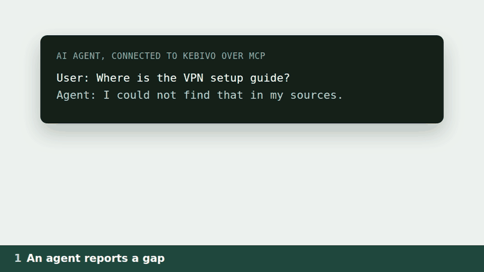
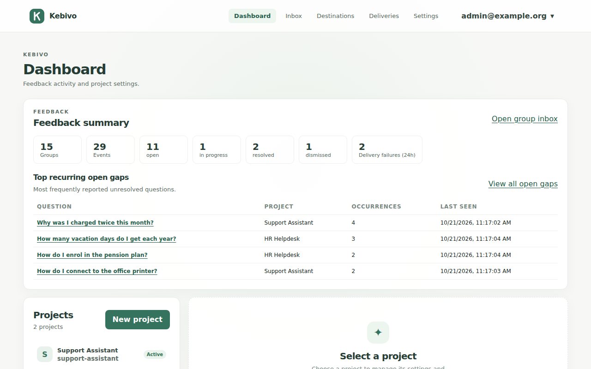
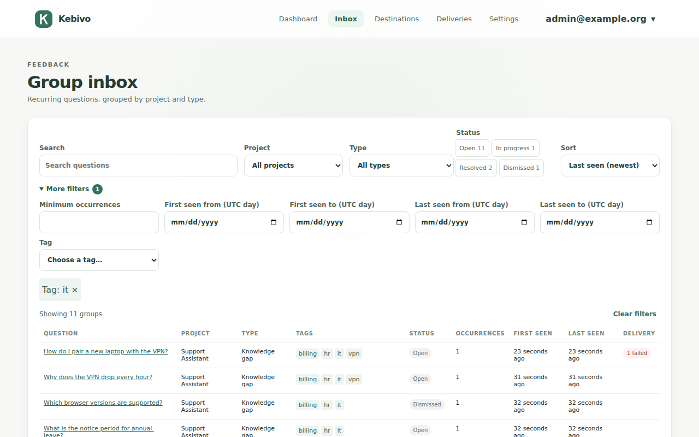
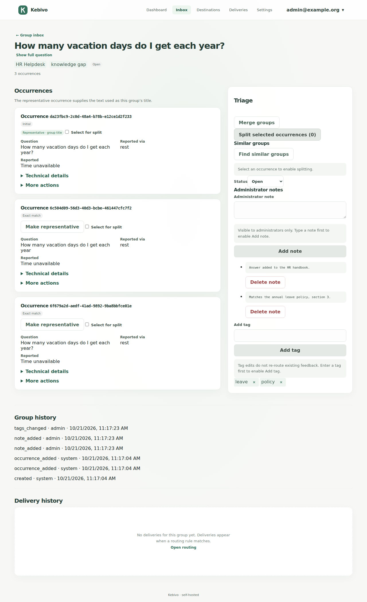
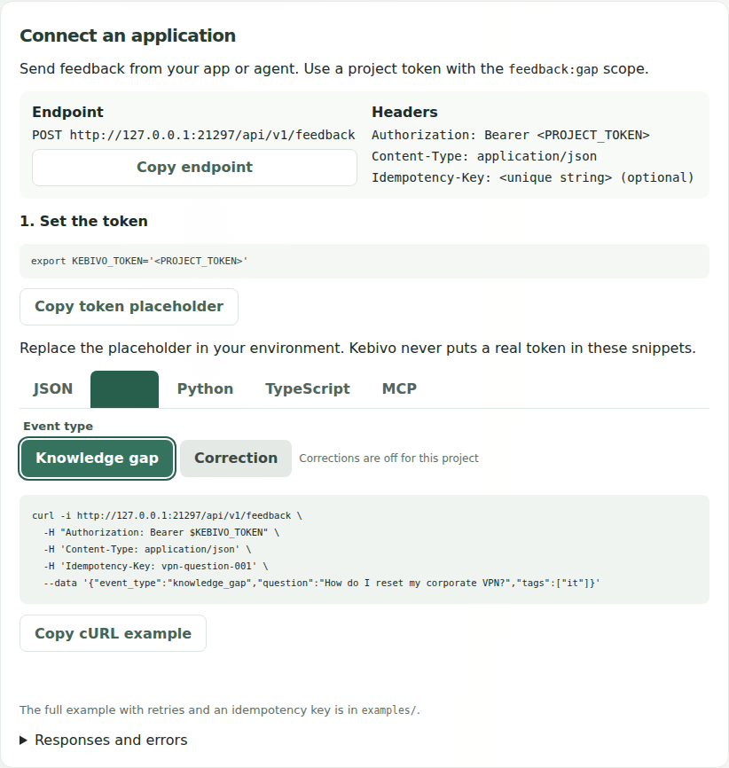
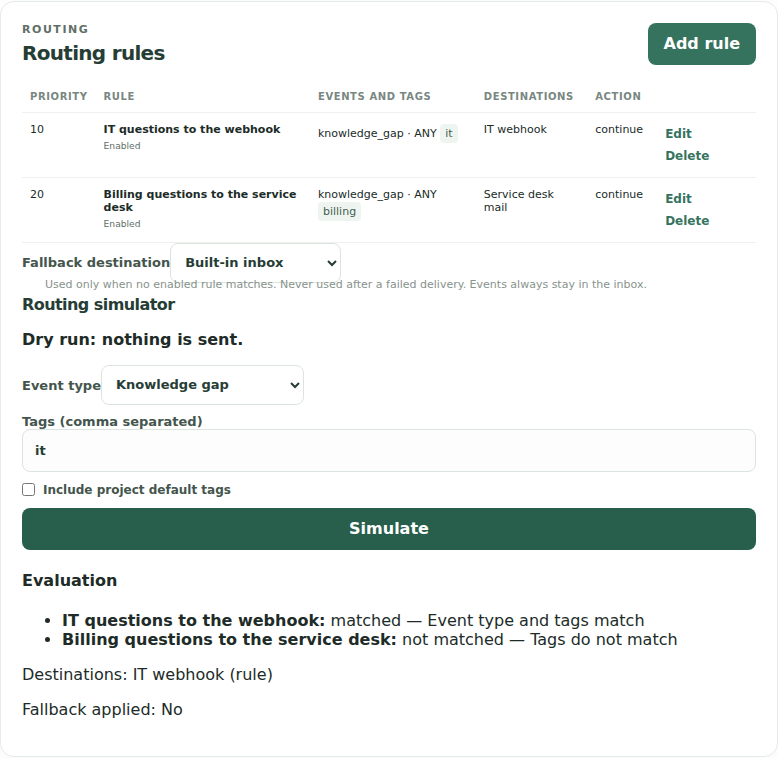
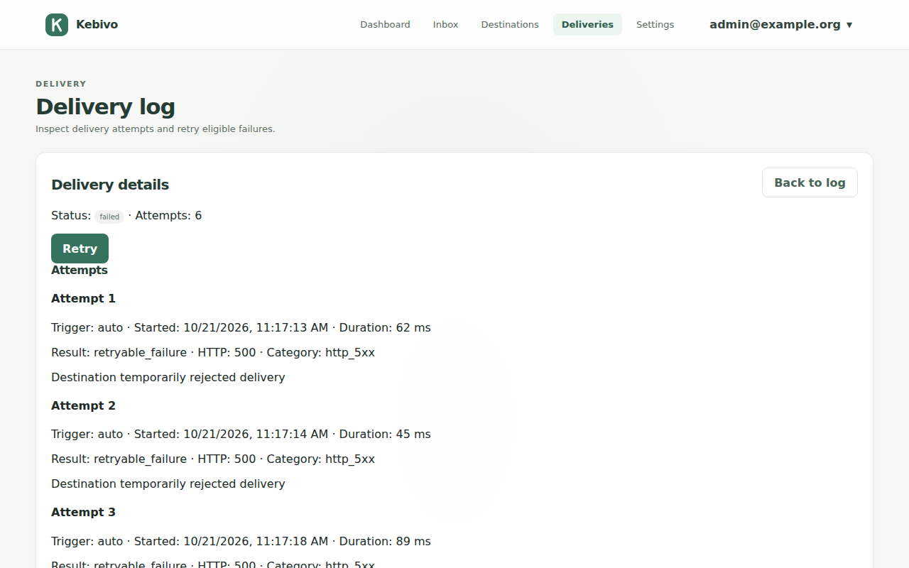

<p align="center">
  <picture>
    <source media="(prefers-color-scheme: dark)" srcset="docs/assets/logo/lockup-dark.svg">
    
  </picture>
</p>

# Kebivo: the inbox for questions your AI couldn't answer

Collect knowledge gaps from your AI app, group repeat questions, and route them to the people who can fix the content.



[](https://github.com/OCNAI/kebivo/actions/workflows/ci.yml)
[](LICENSE)
[](https://github.com/OCNAI/kebivo/releases)
[](https://github.com/OCNAI/kebivo/pkgs/container/kebivo)

> **Status: 0.2.0.** Run the published image `ghcr.io/ocnai/kebivo:0.2.0` (`linux/amd64`, `linux/arm64`) or build it from this repository. Licensed under [Apache-2.0](LICENSE).

Try it with Docker, OpenSSL and a free port 8000:

```sh
(umask 077; printf 'SECRET_KEY=%s\nENCRYPTION_KEY=%s\nALLOWED_ORIGINS=http://127.0.0.1:8000\n' "$(openssl rand -hex 32)" "$(openssl rand -hex 32)" > kebivo.env)
docker run -d --name kebivo --restart unless-stopped -p 127.0.0.1:8000:8000 -v kebivo-data:/data --env-file kebivo.env ghcr.io/ocnai/kebivo:0.2.0
curl -fsS --retry 30 --retry-all-errors --retry-delay 1 http://127.0.0.1:8000/health/ready
```

**Without Kebivo:** A missed question disappears into a chat log; repeated misses stay invisible to the content owner.

**With Kebivo:** The owner sees one inbox group with a repeat count and can route it to the right team.

Continue with the [Quickstart](#quickstart) to report a question. For framework tutorials, see the [Kebivo Guides](https://kebivo.com/guides/).

## Why

When an assistant cannot answer, the documentation owner may never see the question. The same question can fail again, and corrections offered in chat may never reach the people who maintain the content. Kebivo collects those reports in one place, where owners can triage and route them to the tools they use.

## When to use Kebivo

- Your assistant, chatbot or RAG app can identify an unanswered question and report it over REST or MCP.
- The same questions recur, and content owners need a grouped count and inbox to prioritize them.
- Different teams own different topics, so you need to route reports by project or tags to Slack, email or signed webhooks.
- Users suggest corrections (an opt-in setting, off by default), and a person must review them before anyone changes the knowledge source.
- You need a self-hosted feedback workflow that runs without a cloud account or AI provider.

## Features

- Send reports from application code through REST, or give agents the Streamable HTTP MCP tools `report_knowledge_gap` and `submit_knowledge_correction`.
- Create one project per assistant or team, with default tags, a corrections policy, and bearer tokens that are shown once, can expire and can be revoked.
- Route reports with ordered rules, ANY/ALL tag matching, several destinations per rule, a fallback, and a dry-run simulator.
- Deliver to signed webhooks with a versioned JSON payload, SMTP email, or the built-in inbox. Deliveries have durable retries with backoff, restart recovery, a delivery log and manual retry.
- Identical questions are grouped automatically. You can also configure an LLM provider for semantic grouping.
- Triage reports in the inbox with search, filters, statuses, notes, tags, merge, split and deletion. Each group has a full history.
- Enable OpenAI-compatible, Azure OpenAI or local (Ollama, LM Studio) providers for semantic grouping on a per-project basis. This is off by default.
- Run one container with one SQLite file. Startup migrations, online backup and checked restore, retention (on by default), JSON Lines export, and health checks are included.

## Screenshots

All screenshots use synthetic data.

| | |
| --- | --- |
|  |  |
| **Dashboard** | **Inbox** |
|  |  |
| **Feedback group** | **Connect a client** |
|  |  |
| **Routing rules** | **Failed delivery** |

More: [destinations](docs/images/06-destinations.png), [settings](docs/images/08-settings.png), [LLM settings](docs/images/09-llm-settings.png), [sign-in](docs/images/10-sign-in.png). Regenerate them with `make e2e-ui SCREENSHOTS=1`.

The demo's product frames come from a real container with sample data; its chat and end card are drawn. See the [demo source](docs/assets/demo-src/README.md).

## Quickstart

You need Docker, OpenSSL, Python 3 and a free port 8000. The published image is typically ready in about 12 seconds after download.

**1. Start Kebivo from the published image.** Skip this step if you ran the three commands above. Keep `kebivo.env` private and back it up apart from the data volume.

```sh
(umask 077; printf 'SECRET_KEY=%s\nENCRYPTION_KEY=%s\nALLOWED_ORIGINS=http://127.0.0.1:8000\n' \
  "$(openssl rand -hex 32)" "$(openssl rand -hex 32)" > kebivo.env)
docker run -d --name kebivo --restart unless-stopped -p 127.0.0.1:8000:8000 \
  -v kebivo-data:/data --env-file kebivo.env ghcr.io/ocnai/kebivo:0.2.0
curl -fsS --retry 30 --retry-all-errors --retry-delay 1 http://127.0.0.1:8000/health/ready
```

Curl may print a few `Connection reset` errors while migrations run. Readiness returns `{"status":"ok",...}`.

**2. Create an administrator and project token.** The password must have at least 12 characters. The token is issued once into `KEBIVO_TOKEN`; keep it private.

```sh
read -rsp 'Admin password (12+ characters): ' KEBIVO_ADMIN_PASSWORD; printf '\n'
printf '%s\n' "$KEBIVO_ADMIN_PASSWORD" | docker exec -i kebivo python -m kebivo.cli bootstrap --email admin@example.org --password-stdin
unset KEBIVO_ADMIN_PASSWORD
KEBIVO_PROJECT="$(docker exec kebivo python -m kebivo.cli project create --name 'API docs assistant' --json)"
KEBIVO_TOKEN="$(printf '%s' "$KEBIVO_PROJECT" | python3 -c 'import json,sys; print(json.load(sys.stdin)["token"])')"
```

**3. Report the same unanswered question twice.** Use a different idempotency key for each occurrence. Reuse a key only when retrying the *same* request.

```sh
curl -i http://127.0.0.1:8000/api/v1/feedback \
  -H 'Content-Type: application/json' \
  -H "Authorization: Bearer $KEBIVO_TOKEN" \
  -H 'Idempotency-Key: orders-gap-001' \
  --data '{"event_type":"knowledge_gap","question":"How do I paginate the /orders endpoint?","tags":["api-docs"]}'
curl -i http://127.0.0.1:8000/api/v1/feedback \
  -H 'Content-Type: application/json' \
  -H "Authorization: Bearer $KEBIVO_TOKEN" \
  -H 'Idempotency-Key: orders-gap-002' \
  --data '{"event_type":"knowledge_gap","question":"How do I paginate the /orders endpoint?","tags":["api-docs"]}'
```

Both responses are `202 Accepted` with distinct `event_id` values. Open <http://127.0.0.1:8000/>, sign in, and find **How do I paginate the /orders endpoint?** in the Inbox with **2 occurrences**. Use exactly `127.0.0.1`: `localhost` is a different origin, and sign-in names the allowed origin if you use the wrong one. You can also create projects and tokens in the UI.

For a signed webhook delivery, follow step 4 of the [Docker guide](docs/quickstart.md).

> **REST or MCP?** Call REST from your application's fallback when every miss must be captured. With MCP, the model decides whether to call `report_knowledge_gap`, so some misses may go unreported.

## Where Kebivo fits

Kebivo works alongside Langfuse and Phoenix, which help engineers inspect runs. Kebivo collects and routes misses; it does not diagnose why retrieval failed. It does not answer questions, update a knowledge base, or apply proposed corrections; people review the reports. Use something else if you need a ticketing system, analytics, multi-user accounts, SSO, or high availability. Kebivo is self-hosted with one local administrator, one process and one SQLite file. See the [technical documentation](docs/index.md) for deployment and limits.

## Build from source

Use this path if you want to change the code. After it starts, replace both `docker exec -i kebivo` and `docker exec kebivo` with `docker compose exec -T app` in step 2.

```sh
git clone https://github.com/OCNAI/kebivo.git
cd kebivo
cp .env.example .env
printf 'SECRET_KEY=%s\n' "$(openssl rand -hex 32)" >> .env
printf 'ENCRYPTION_KEY=%s\n' "$(openssl rand -hex 32)" >> .env
printf 'ALLOWED_ORIGINS=http://127.0.0.1:8000\n' >> .env
docker compose up --build -d
curl -fsS --retry 30 --retry-all-errors --retry-delay 1 http://127.0.0.1:8000/health/ready
```

To stop the published image: `docker stop kebivo` (data stays in the volume). To stop a Compose build: `docker compose down` (data is kept). `docker compose down --volumes` **deletes all data**. For production (TLS, backups, upgrades, every setting), read the [self-hosting guide](docs/self-hosting.md).

## Collect AI agent feedback with REST

Send `POST /api/v1/feedback` with a project token. A `202` means the report is stored durably; routing and delivery happen in the background. Send an `Idempotency-Key` and reuse it on retries. Retry `429` and `5xx` responses with backoff; do not retry other `4xx` errors.

For Python applications, install the `kebivo-client` distribution from the [standalone Python SDK](sdk/python/README.md) directly from GitHub with `pip install "git+https://github.com/OCNAI/kebivo#subdirectory=sdk/python"` (not published to PyPI):

```python
from kebivo_client import Kebivo

client = Kebivo("https://your-kebivo.example", "<PROJECT_TOKEN>")
accepted = client.report_gap("How do I reset my VPN?", tags=["it"])
print(accepted["event_id"])
```

For Node 20+ applications, use the [standalone TypeScript SDK](sdk/typescript/README.md) from a local path. It has no runtime dependencies and is not published to npm. Keep project tokens on the server; never embed them in browser code.

Runnable clients for [cURL](examples/rest_curl.sh), [Python](examples/rest_python.py) (standard library) and [TypeScript](examples/rest_typescript.ts) (Node.js 24, no build step) are in [`examples/`](examples/), and the project page in the UI shows the same snippets with your endpoint. The [REST integration guide](docs/rest-api.md) covers fields, authentication, idempotency, errors, retries and rate limits.

## Report knowledge gaps with MCP

Point an MCP client at `http://127.0.0.1:8000/mcp` with the header `Authorization: Bearer <PROJECT_TOKEN>`. For Claude Code:

```sh
claude mcp add --transport http kebivo http://127.0.0.1:8000/mcp --header "Authorization: Bearer <PROJECT_TOKEN>"
```

Tokens with `feedback:gap` see `report_knowledge_gap`; `submit_knowledge_correction` also needs `feedback:correction` and a project that accepts corrections. A model may not call a tool when it should, so use REST where every report matters. See the [MCP guide](docs/mcp.md), a [client configuration](examples/mcp-client-config.json), a [Python client](examples/mcp_client.py) and copyable [agent instructions](examples/agent-instructions.md).

## Destinations and routing

| Destination | What it sends |
| --- | --- |
| Built-in inbox | Always available; every event is in the admin inbox. |
| Webhook | HTTPS `POST` with a [versioned JSON payload](docs/webhook-payload.schema.json), Standard Webhooks signatures, optional bearer or custom headers. A [receiver example](examples/webhook_receiver.py) verifies both. |
| SMTP email | A message (plain text with an escaped HTML alternative) to 1–20 recipients over STARTTLS, implicit TLS, or an unauthenticated local relay. |

Each project has ordered rules: a rule matches ANY or ALL of its tags and sends to one or more destinations, optionally stopping evaluation. Unmatched events go to the fallback destinations. For example, `it` → IT email, `customer-service` → the support webhook. Each destination delivers either for new groups only or for every occurrence. See [routing](docs/routing.md) and [destinations](docs/destinations.md).

## Optional AI

No model is called by default. To group questions that are worded differently, configure an LLM provider (**LLM settings** in the UI) and switch a project to semantic deduplication after acknowledging that question text will be sent to that provider. If the provider fails, the event keeps its own group and is still routed and delivered. See [deduplication](docs/deduplication.md) and [LLM providers](docs/llm-providers.md).

Embeddings are an opt-in, precision-first option that needs an [embedding endpoint](docs/llm-providers.md#ollama-recipe); the default install groups exact repeats only. With `nomic-embed-text`, the default 0.93 threshold grouped only about 3% of paraphrases in a 150-pair synthetic test; use the LLM judge method for useful paraphrase grouping.

## Security

- Run behind a TLS reverse proxy and keep the app port on loopback ([guide](docs/self-hosting.md#reverse-proxy-and-tls)).
- Keep `.env` private. Back up `SECRET_KEY` and `ENCRYPTION_KEY` separately from database backups.
- Feedback is stored **unencrypted** in SQLite. Protect the volume and backups, and do not ask assistants to send secrets or unnecessary personal data.
- Give each client its own token, give customer-facing agents only `feedback:gap`, and revoke tokens you no longer use.
- Webhooks and LLM providers cannot reach private or loopback addresses unless you opt in per destination or provider; cloud metadata addresses are always blocked, also for SMTP. Admin writes need the configured Origin and a CSRF token.
- Logs never contain feedback content or credentials.

Report vulnerabilities as described in [`SECURITY.md`](SECURITY.md).

## Data, retention and export

Retention is **on by default**: feedback older than 180 days, finished delivery attempt details older than 30 days, and audit entries older than 90 days are deleted daily. Change or disable each with an environment variable (`0` turns it off). Retention does not touch backups you already made. An administrator can export a project's feedback as JSON Lines. See [retention](docs/retention.md) and [export](docs/export.md).

## Known limits

- **At-least-once delivery.** A receiver may see a delivery twice; deduplicate by the webhook ID or delivery ID.
- **One administrator, one instance, one SQLite file** on local storage. No replicas, no network filesystem.
- **MCP** needs a manually configured bearer token; OAuth-only clients cannot connect. Responses are stateless JSON without streaming notifications.
- **Rate limits** are counted in memory and reset when the container restarts.
- **Deleted feedback** cannot be recalled from destinations that already received it or from existing backups.
- **No encryption at rest** for feedback content.

## Documentation

Framework tutorials are in the [website Guides](https://kebivo.com/guides/). Runnable clients and framework examples are in [`examples/`](examples/). The pages below cover the technical details.

| Guide | Contents |
| --- | --- |
| [Self-hosting](docs/self-hosting.md) | Requirements, every setting, TLS proxy, secrets, backup and restore, upgrades, credential rotation, troubleshooting |
| [REST API](docs/rest-api.md) | Authentication, fields, idempotency, errors, retries, examples |
| [MCP](docs/mcp.md) | Connecting clients, tools and permissions, testing, limitations |
| [Routing](docs/routing.md) and [destinations](docs/destinations.md) | Rules, fallback, webhooks, signatures, SMTP |
| [Deduplication](docs/deduplication.md) and [LLM providers](docs/llm-providers.md) | Exact and semantic grouping, providers, privacy |
| [Feedback management](docs/feedback-management.md) | Groups, search syntax, statuses, merge, split, deletion |
| [Retention](docs/retention.md) and [export](docs/export.md) | Automatic deletion, JSON Lines export |
| [Releasing](docs/releasing.md) | Versioning, image labels, release and upgrade checks |
| [Third-party licenses](docs/licenses.md) | Inventory of shipped dependencies |
| [Changelog](CHANGELOG.md) | User-visible changes per version |

## Contributing

Development setup, `make` targets, style, tests and the documentation rule are in [`CONTRIBUTING.md`](CONTRIBUTING.md). In short: `make install`, then `make check` before every commit, and update the docs in the same change. Sign off every commit (`git commit -s`) under the [Developer Certificate of Origin](CONTRIBUTING.md#developer-certificate-of-origin); there is no CLA.

Everyone taking part follows the [Code of Conduct](CODE_OF_CONDUCT.md). Ideas under consideration, none of them committed, are in the [roadmap](ROADMAP.md).

## License

Kebivo is licensed under the [Apache License 2.0](LICENSE). Contributions are accepted under the same license with a [Developer Certificate of Origin](CONTRIBUTING.md#developer-certificate-of-origin) sign-off; there is no CLA. The [third-party license inventory](docs/licenses.md) lists the licenses of everything the image ships.
