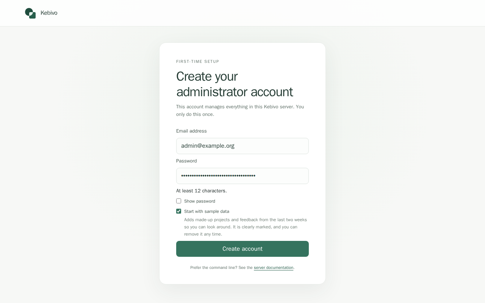

# Run Kebivo with Docker

You need Docker, Python 3 and a free port 8000. Run the commands in bash; on macOS, type `bash` first, because zsh's `read` doesn't accept `-p` for a prompt. The published image is typically ready in about 12 seconds after download.

**1. Start Kebivo from the published image.** Keep this terminal open: the container prints a one-time setup link here.

```sh
docker run --name kebivo -p 127.0.0.1:8000:8000 \
  -v kebivo-data:/data ghcr.io/ocnai/kebivo:0.3.0
```

Open the printed `Kebivo setup:` link in your browser. It expires after 60 minutes; restart the container for a new link. Create your administrator with a password of at least 12 characters. **Start with sample data** is selected by default; it opens a filled inbox with labelled, removable examples. If you map another host port, change `8000` in the printed link to that port. The generated keys live in the named volume; [protect them before using real credentials](self-hosting.md#secrets-and-what-to-protect).



**2. Report the same unanswered question twice.** In **Projects**, create a real project named **Shop assistant** and a token. Copy the token when shown; it is issued once. In a second terminal, enter it. Use a different idempotency key for each occurrence. Reuse a key only when retrying the *same* request.

```sh
read -rsp 'Project token: ' KEBIVO_TOKEN; printf '\n'
```

```sh
curl -i http://127.0.0.1:8000/api/v1/feedback \
  -H 'Content-Type: application/json' \
  -H "Authorization: Bearer $KEBIVO_TOKEN" \
  -H 'Idempotency-Key: canada-gap-001' \
  --data '{"event_type":"knowledge_gap","question":"Do you ship to Canada?","tags":["shipping"]}'
curl -i http://127.0.0.1:8000/api/v1/feedback \
  -H 'Content-Type: application/json' \
  -H "Authorization: Bearer $KEBIVO_TOKEN" \
  -H 'Idempotency-Key: canada-gap-002' \
  --data '{"event_type":"knowledge_gap","question":"Do you ship to Canada?","tags":["shipping"]}'
```

Both responses are `202 Accepted` with distinct `event_id` values. Find **Do you ship to Canada?** from your **Shop assistant** project in the Inbox with **2 occurrences**. The row with 7 occurrences is labelled **Sample**: sample rows stay separate from yours, and you can remove them using the sample-data banner.

**If this fails:** A `401` means the project token is missing or invalid; create a new token in **Projects** and retry. If Docker says port 8000 is already allocated, map an unused host port and use it in the URLs. If the setup link has expired, restart the container and open the new link printed in its log.

To report unanswered questions from your own chatbot, see [Report from your own app](report-from-your-app.md).

**3. Route shipping questions to a signed local webhook.** This stands in for the person who owns the shipping docs. Run this and the next step in the second terminal; they reuse `KEBIVO_TOKEN`. Enter the administrator email and password you chose during setup. The destination returns its signing secret once; keep it private. `allow_private_network: true` lets this destination reach private addresses, so use it only for a trusted receiver.

```sh
read -rsp 'Admin password: ' KEBIVO_ADMIN_PASSWORD; printf '\n'
read -rp 'Admin email: ' KEBIVO_ADMIN_EMAIL
KEBIVO_COOKIES="$(mktemp)"
KEBIVO_LOGIN="$(KEBIVO_ADMIN_PASSWORD="$KEBIVO_ADMIN_PASSWORD" KEBIVO_ADMIN_EMAIL="$KEBIVO_ADMIN_EMAIL" python3 -c 'import json,os; print(json.dumps({"email":os.environ["KEBIVO_ADMIN_EMAIL"],"password":os.environ["KEBIVO_ADMIN_PASSWORD"]}))' |
  curl -fsS -c "$KEBIVO_COOKIES" -H 'Origin: http://127.0.0.1:8000' -H 'Content-Type: application/json' --data-binary @- http://127.0.0.1:8000/api/v1/auth/login)"
unset KEBIVO_ADMIN_PASSWORD
KEBIVO_CSRF="$(printf '%s' "$KEBIVO_LOGIN" | python3 -c 'import json,sys; print(json.load(sys.stdin)["csrf_token"])')"
KEBIVO_PROJECT_ID="$(curl -fsS -b "$KEBIVO_COOKIES" 'http://127.0.0.1:8000/api/v1/projects?limit=100' | python3 -c 'import json,sys; print(next(p["id"] for p in json.load(sys.stdin)["items"] if p["name"] == "Shop assistant" and not p["is_sample"]))')"
KEBIVO_DESTINATION="$(curl -fsS -b "$KEBIVO_COOKIES" -H 'Origin: http://127.0.0.1:8000' -H "X-CSRF-Token: $KEBIVO_CSRF" -H 'Content-Type: application/json' \
  --data '{"name":"Shipping docs webhook","type":"webhook","allow_private_network":true,"config":{"url":"http://127.0.0.1:9000/hook","signing":true,"auth":{"type":"none"}}}' \
  http://127.0.0.1:8000/api/v1/destinations)"
KEBIVO_DESTINATION_ID="$(printf '%s' "$KEBIVO_DESTINATION" | python3 -c 'import json,sys; print(json.load(sys.stdin)["id"])')"
WEBHOOK_SECRET="$(printf '%s' "$KEBIVO_DESTINATION" | python3 -c 'import json,sys; print(json.load(sys.stdin)["signing_secret"])')"
```

Get the [stdlib receiver](../examples/webhook_receiver.py) and its [payload schema](webhook-payload.schema.json), then run it in Kebivo's container. This keeps the receiver on container loopback and works with the published image or a Compose build (replace `kebivo` with the Compose app container ID). The last command waits up to 15 seconds for the receiver to start listening, so the delivery doesn't arrive before it.

```sh
mkdir -p examples docs
curl -fsS https://raw.githubusercontent.com/OCNAI/kebivo/v0.3.0/examples/webhook_receiver.py -o examples/webhook_receiver.py
curl -fsS https://raw.githubusercontent.com/OCNAI/kebivo/v0.3.0/docs/webhook-payload.schema.json -o docs/webhook-payload.schema.json
docker cp examples/webhook_receiver.py kebivo:/tmp/webhook_receiver.py
docker cp docs/webhook-payload.schema.json kebivo:/tmp/webhook-payload.schema.json
rm -f kebivo-webhook.log
WEBHOOK_SECRET="$WEBHOOK_SECRET" docker exec -e WEBHOOK_SECRET kebivo python /tmp/webhook_receiver.py \
  --schema /tmp/webhook-payload.schema.json --exit-after 1 > kebivo-webhook.log 2>&1 &
sh -c 'i=0; until grep -q listening kebivo-webhook.log || [ $i -ge 30 ]; do sleep 0.5; i=$((i+1)); done'; cat kebivo-webhook.log
```

The log shows `{"listening": "127.0.0.1:9000"}`. Now add a rule that sends `shipping` reports to the webhook, and report the question a third time.

```sh
curl -fsS -o /dev/null -b "$KEBIVO_COOKIES" -H 'Origin: http://127.0.0.1:8000' -H "X-CSRF-Token: $KEBIVO_CSRF" -H 'Content-Type: application/json' \
  --data "{\"name\":\"Shipping questions to the docs owner\",\"event_types\":[\"knowledge_gap\"],\"tags\":[\"shipping\"],\"match_mode\":\"any\",\"priority\":1,\"destination_ids\":[\"$KEBIVO_DESTINATION_ID\"],\"match_behavior\":\"stop\"}" \
  "http://127.0.0.1:8000/api/v1/projects/$KEBIVO_PROJECT_ID/routing-rules"
curl -i http://127.0.0.1:8000/api/v1/feedback -H 'Content-Type: application/json' \
  -H "Authorization: Bearer $KEBIVO_TOKEN" -H 'Idempotency-Key: canada-gap-003' \
  --data '{"event_type":"knowledge_gap","question":"Do you ship to Canada?","tags":["shipping"]}'
```

The report joins the same group, now with 3 occurrences, and the new route delivers it once. By default a destination gets a group's first routed report; later repeats only raise the count. Check the receiver log and the Delivery log:

```sh
sh -c 'i=0; until grep -q "\"signature\": \"valid\"" kebivo-webhook.log || [ $i -ge 20 ]; do sleep 1; i=$((i+1)); done'; sleep 1; cat kebivo-webhook.log
curl -fsS -b "$KEBIVO_COOKIES" "http://127.0.0.1:8000/api/v1/deliveries?destination_id=$KEBIVO_DESTINATION_ID" |
  python3 -c 'import json,sys; [print(d["status"], "attempts=" + str(d["attempt_count"]), d["last_error_category"] or "") for d in json.load(sys.stdin)["items"]]'
```

The receiver log ends with a line containing `"question": "Do you ship to Canada?"`, `"signature": "valid"` and `"schema": "valid"`, and the Delivery log prints `delivered attempts=1 http_2xx`. A retry looks like `retry_scheduled attempts=1 connect`: the receiver wasn't reachable, and Kebivo tries again after about 30 seconds, then 2 and 10 minutes. If you see it, run `cat kebivo-webhook.log`. If the `listening` line is missing, the receiver didn't start: run the receiver command again (from `rm -f kebivo-webhook.log` through the wait), then run the two check commands after a minute. **Delivery log** in the UI shows each attempt.

**4. Resolve the group.** When the shipping docs answer the question, mark the group resolved. In the UI, open your **Do you ship to Canada?** group (not the Sample one) in the Inbox and set **Status** to **Resolved** under **Triage**. Or use the API:

```sh
KEBIVO_GROUP_ID="$(curl -fsS -b "$KEBIVO_COOKIES" "http://127.0.0.1:8000/api/v1/admin/groups?project_id=$KEBIVO_PROJECT_ID&tag=shipping" |
  python3 -c 'import json,sys; print(json.load(sys.stdin)["items"][0]["id"])')"
curl -fsS -X PATCH -b "$KEBIVO_COOKIES" -H 'Origin: http://127.0.0.1:8000' -H "X-CSRF-Token: $KEBIVO_CSRF" -H 'Content-Type: application/json' \
  --data '{"status":"resolved"}' "http://127.0.0.1:8000/api/v1/admin/groups/$KEBIVO_GROUP_ID" |
  python3 -c 'import json,sys; print(json.load(sys.stdin)["status"])'
rm -f "$KEBIVO_COOKIES" kebivo-webhook.log
unset KEBIVO_LOGIN KEBIVO_DESTINATION WEBHOOK_SECRET KEBIVO_CSRF KEBIVO_TOKEN KEBIVO_ADMIN_EMAIL
```

It prints `resolved`, and the Inbox shows the group as **Resolved** with 3 occurrences. If the question is reported again later, the group reopens and the route sends it to the webhook again.

You can also do the step 3 setup in the UI: sign in, create a signed webhook at **Destinations** with URL `http://127.0.0.1:9000/hook` and **Allow private network**, copy its one-time signing secret, then add a `shipping` rule for it under the project's **Routing** section. Start the receiver with that secret and wait for its `listening` line before sending the third report.

**Build from source instead.** Use this path if you want to change the code. Compose requires keys in `.env` and still supports the CLI bootstrap.

```sh
git clone https://github.com/OCNAI/kebivo.git
cd kebivo
cp .env.example .env
printf 'SECRET_KEY=%s\n' "$(openssl rand -hex 32)" >> .env
printf 'ENCRYPTION_KEY=%s\n' "$(openssl rand -hex 32)" >> .env
printf 'ALLOWED_ORIGINS=http://127.0.0.1:8000\n' >> .env
docker compose up --build -d
curl -fsS --retry 30 --retry-all-errors --retry-delay 1 http://127.0.0.1:8000/health/ready
```

To stop the published image: `docker stop kebivo` (data stays in the volume). To stop a Compose build: `docker compose down` (data is kept). `docker compose down --volumes` **deletes all data**. For production (TLS, backups, upgrades, every setting), read the [self-hosting guide](self-hosting.md).

Next: [REST API](rest-api.md) or [MCP](mcp.md).
